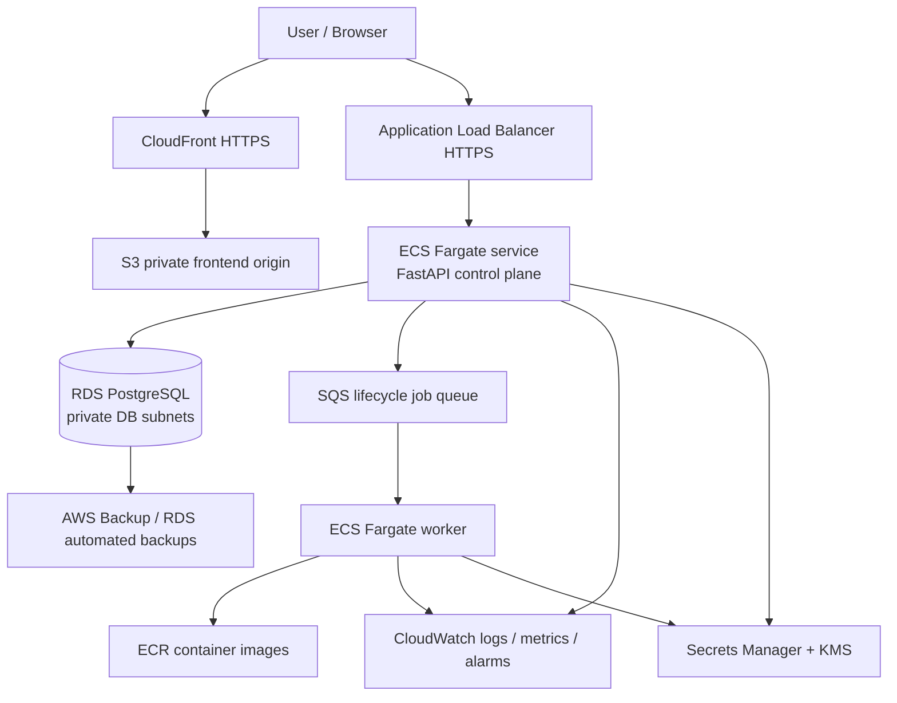

# CloudCapsule — AWS Cloud Architecture

## Status and scope

This document describes the proposed AWS deployment architecture for CloudCapsule. The current application remains a local development deployment using Docker Compose, FastAPI, and PostgreSQL. The lifecycle action endpoints currently simulate deployment and do not provision AWS resources.

**This is a design, not a deployed environment.** No AWS resources have been created by producing these files.

## Proposed architecture

The diagram is logical. The final implementation should configure the API origin and frontend origin routing deliberately; CloudFront can serve the frontend and forward `/api/*` to the ALB to simplify browser CORS.

## Network layout

Use one VPC across two Availability Zones for a production-oriented design:

- Public subnets: Application Load Balancer only.
- Private application subnets: ECS API tasks and lifecycle worker tasks.
- Isolated private database subnets: RDS PostgreSQL.
- Security groups: internet ingress only to ALB on HTTPS; ALB to API on the application port; API/worker to database on PostgreSQL; no public database address.
- Outbound access: decide between NAT gateways and VPC endpoints after cost review. Two NAT gateways improve AZ independence but add recurring cost. For a student demo, evaluate a single NAT gateway or endpoint-based access only after understanding the availability trade-off.

Do not assign public IPs to ECS tasks or RDS.

## Compute and lifecycle design

- Amazon ECR stores versioned container images.
- ECS Fargate runs the FastAPI control-plane service.
- A separate worker service consumes lifecycle jobs from SQS.
- SQS dead-letter queue stores jobs that repeatedly fail.
- ECS service auto scaling is based on measured CPU/memory and queue depth, with explicit minimum and maximum task counts.
- The current lifecycle endpoints only simulate actions. Actual AWS orchestration requires a separately implemented worker, IAM permissions, idempotency, job state tracking, retries, and audit logging before it should be enabled.

## Data and storage

- Amazon RDS for PostgreSQL stores module definitions, design metadata, and lifecycle events.
- Keep RDS in private DB subnets; enable encryption at rest and TLS in transit.
- S3 stores frontend build assets. Enable versioning; use CloudFront Origin Access Control so the bucket is not public.
- If future module workloads need persistent files, define a separate S3 data bucket and explicit retention policy instead of using the frontend bucket.

## Security

- Use separate IAM task roles for the API and worker; grant only the actions each requires.
- Store database credentials and API secrets in Secrets Manager, encrypted with KMS.
- Use HTTPS with ACM-managed certificates.
- Consider AWS WAF on CloudFront or ALB if the threat model and budget justify it.
- Enable CloudTrail for account activity; centralize application and infrastructure logs in CloudWatch.
- Never commit `.env`, credentials, private keys, Terraform state, or secret values to Git.
- Protect Terraform state in an encrypted, versioned S3 bucket with tightly scoped access and locking appropriate to the selected Terraform/backend version.

## Monitoring and operations

Create CloudWatch dashboards and alarms for API 5xx rate, latency, task restarts, CPU/memory, RDS connections/storage, SQS queue depth, DLQ messages, and backup failures. Add actionable alarm destinations only after selecting an approved notification channel and cost budget.

## Backup and disaster recovery

Initial *proposed objectives*, not guarantees:
- RPO: up to 24 hours for a low-cost demo.
- RTO: up to 4 hours for a low-cost demo.

Enable RDS automated backups with a retention period approved for the data, test point-in-time recovery, and consider AWS Backup for policy-based retention. Enable S3 versioning and document restoration steps. Multi-AZ RDS improves availability but does not replace backups. Perform restore drills and record actual recovery time before claiming the RPO/RTO targets are achieved.

## Availability and scaling

A production-oriented design uses at least two AZs, ALB health checks, ECS health checks, multiple task replicas, and Multi-AZ RDS. A cost-constrained demo can use fewer resources, but must clearly document reduced availability and recovery guarantees.

## Deployment stages

1. Review architecture, region, traffic assumptions, security, and budget.
2. Estimate cost with AWS Pricing Calculator.
3. Review Terraform plan locally.
4. Review every resource and estimated cost.
5. Obtain explicit approval before any `terraform apply` or AWS deployment.
6. Deploy to a sandbox account, verify health and alarms, test backup restoration, and document teardown.
