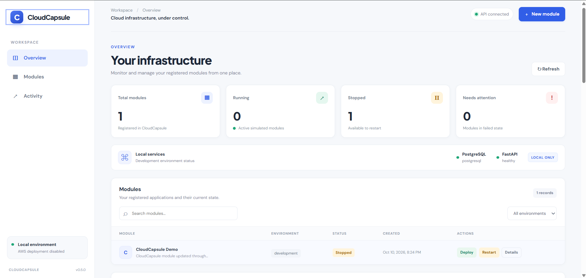
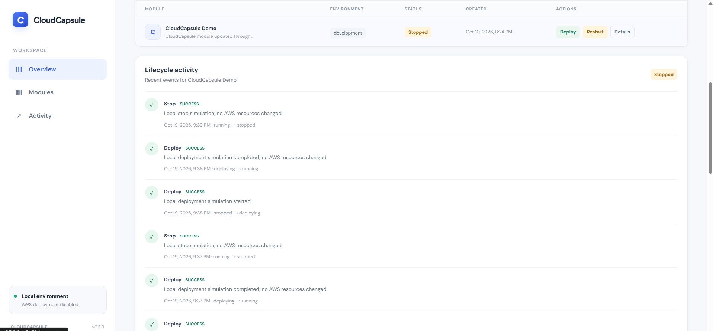
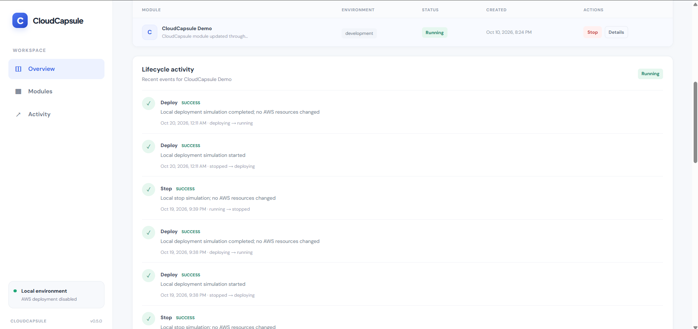
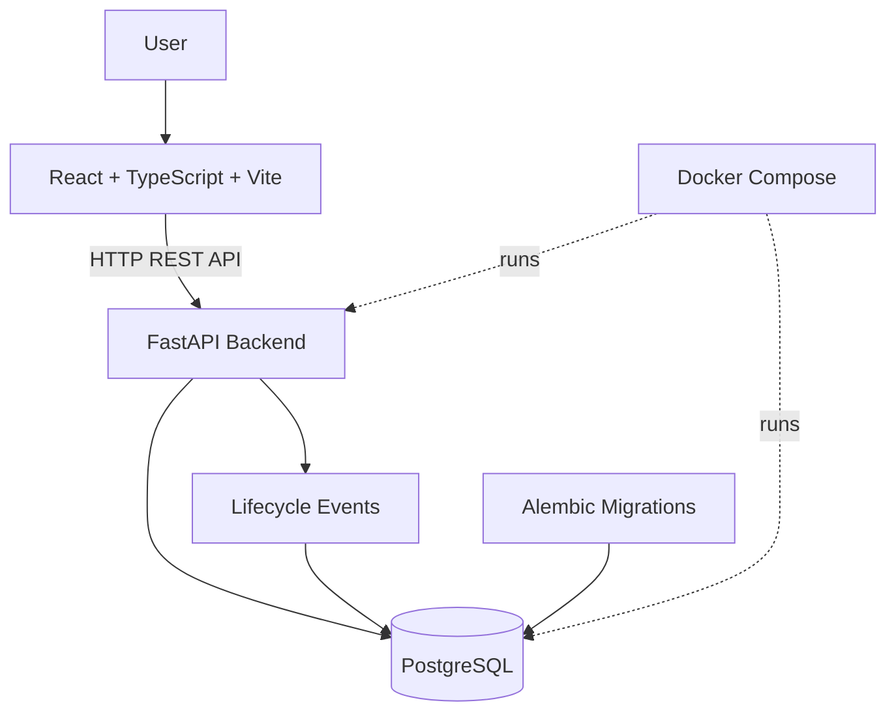

# CloudCapsule

**A containerized cloud module lifecycle management platform.**

CloudCapsule is a local-first application for registering application modules, managing their lifecycle states, and tracking lifecycle events through a REST API and a web dashboard. It combines a React frontend, a FastAPI backend, and PostgreSQL persistence in a Docker Compose development environment.

> **Project status:** The local application is implemented and tested. Lifecycle actions are simulated locally; AWS infrastructure provisioning and deployment are planned, not implemented.

## Screenshots

### Dashboard Overview



### Lifecycle Activity and Audit History



### Module Running State



## Features

- **Module management:** Register, list, retrieve, and update application modules.
- **Lifecycle management:** Simulate Deploy, Stop, and Restart operations with validated state transitions.
- **Audit history:** Record successful and rejected lifecycle actions.
- **Web dashboard:** View module statuses, environment information, service health, and lifecycle activity.
- **Database reliability:** Use PostgreSQL transactions and row-level locking for lifecycle operations.
- **Schema migrations:** Manage database schema changes using Alembic.
- **API documentation:** Explore and test endpoints using FastAPI's interactive Swagger UI.
- **Automated testing:** Test API behavior, lifecycle transitions, concurrency, rollback, and database configuration.
- **Responsive interface:** Support mobile, tablet, and desktop layouts.

## Architecture



The frontend communicates with the backend over HTTP. The backend validates requests, manages module lifecycle transitions, and persists module information and lifecycle events in PostgreSQL.

Docker Compose provides the local backend and database environment. AWS deployment is outside the current implementation.

## Technology Stack

| Layer | Technologies |
|---|---|
| Frontend | React, TypeScript, Vite, CSS |
| Backend | Python, FastAPI |
| Database | PostgreSQL |
| Database migrations | Alembic |
| Containerization | Docker, Docker Compose |
| Testing | Pytest, FastAPI TestClient |
| API documentation | OpenAPI, Swagger UI |

## Prerequisites

Install the following before running CloudCapsule:

- Git
- Docker Desktop with Docker Compose
- Node.js and npm

Python dependencies for the backend are installed inside the Docker image.

## Getting Started

### 1. Clone the repository

```bash
git clone https://github.com/lakshetha-rr/CloudCapsule.git
cd CloudCapsule
```

### 2. Configure environment variables

Create a root `.env` file based on `.env.example`.

In PowerShell:

```powershell
Copy-Item .env.example .env
```

Open `.env` and configure `DATABASE_URL` for the local PostgreSQL service according to the existing Compose configuration. Do not commit `.env` or real credentials.

### 3. Start the backend and database

From the repository root, run:

```powershell
docker compose up -d --build
```

Check the service status:

```powershell
docker compose ps
```

### 4. Start the frontend

Open a second terminal:

```powershell
cd frontend
npm install
npm run dev -- --host 127.0.0.1
```

Open the local URL printed by Vite in your browser. The default address is usually `http://127.0.0.1:5173/`; if that port is occupied, Vite may select another port.

### 5. Verify the backend

- Health check: `http://localhost:8000/health`
- Database health: `http://localhost:8000/health/database`
- Interactive API documentation: `http://localhost:8000/docs`

## API Endpoints

| Method | Endpoint | Purpose |
|---|---|---|
| GET | `/health` | Check API health |
| GET | `/health/database` | Check database connectivity |
| POST | `/modules` | Register a module |
| GET | `/modules` | List registered modules |
| GET | `/modules/{id}` | Retrieve a module |
| PATCH | `/modules/{id}` | Update module information |
| POST | `/modules/{id}/actions` | Request a lifecycle action |
| GET | `/modules/{id}/events` | Retrieve module lifecycle events |

Use the interactive Swagger UI at `/docs` to inspect request schemas and try the endpoints.

## Module Lifecycle

CloudCapsule simulates module lifecycle operations and validates permitted state transitions.

| Action | Purpose |
|---|---|
| Deploy | Simulate deploying a module |
| Stop | Simulate stopping a running module |
| Restart | Simulate restarting a stopped module |

Invalid transitions are rejected, and lifecycle events are recorded for auditing.

**Important:** These operations are local simulations. They do not provision, deploy, stop, or modify actual AWS resources.

## Running Tests

From the repository root, run the backend test suite inside the backend container:

```powershell
docker compose exec backend pytest -q
```

To check whether the Alembic schema matches the application's models:

```powershell
docker compose exec backend alembic check
```

To verify the frontend production build, run:

```powershell
cd frontend
npm run build
```

## Project Structure

```text
CloudCapsule/
├── backend/
│   ├── app/
│   ├── tests/
│   ├── alembic/
│   └── Dockerfile
├── frontend/
│   ├── src/
│   ├── public/
│   └── package.json
├── screenshots/
│   ├── dashboard-desktop.png
│   ├── module-details_1.png
│   ├── module-details_2.png
│   ├── module-details_3.png
│   └── module-running.png
├── compose.yaml
├── .env.example
├── .gitignore
└── README.md
```

## Security and Development Notes

- Environment secrets should remain in `.env`, which must not be committed.
- `.env.example` should contain placeholders or local development configuration only.
- Lifecycle actions currently operate in local simulation mode.
- AWS infrastructure provisioning and deployment are planned future work, not implemented features.

## Future Improvements

- Integrate AWS infrastructure provisioning after architecture and cost review.
- Add authentication and role-based access control.
- Improve observability, operational metrics, and event filtering.
- Add deployment configuration and cloud resource state tracking.

## License

No license has been specified yet. All rights and reuse permissions remain subject to the repository owner's terms until a license is added.
