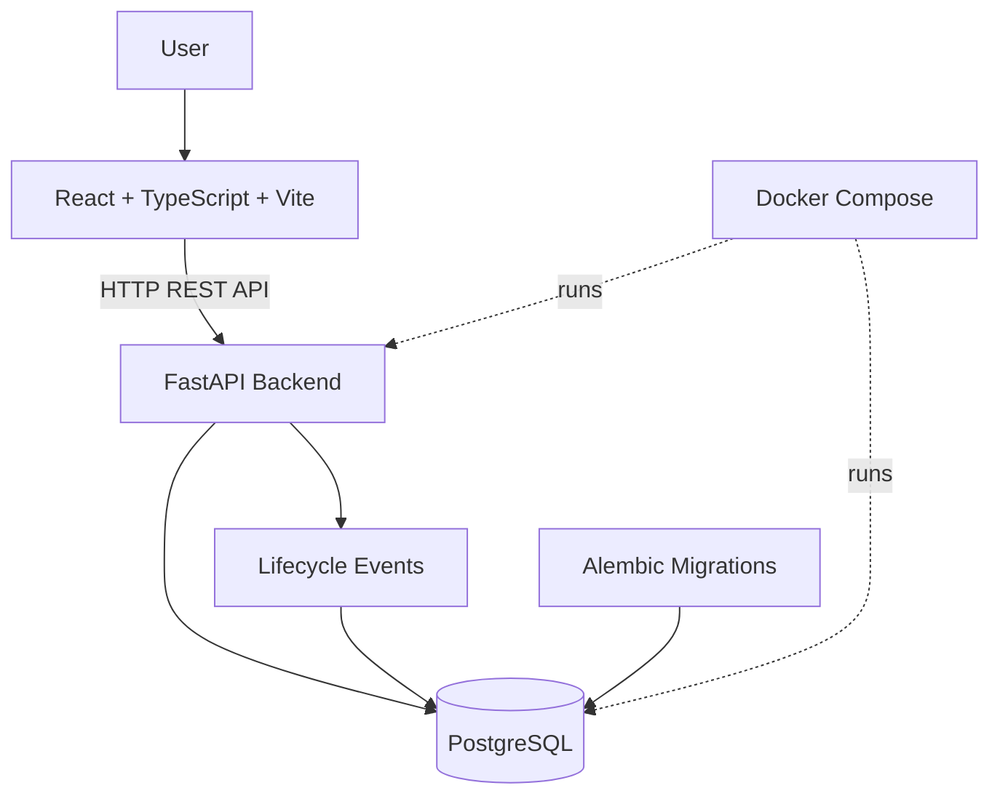

# CloudCapsule

**A containerized cloud module lifecycle management platform.**

CloudCapsule is a local-first application for registering application modules, managing their lifecycle states, and tracking lifecycle events through a REST API and a web dashboard. It combines a React frontend, a FastAPI backend, and PostgreSQL persistence in a Docker Compose development environment.

> **Project status:** The local application is implemented and tested. Lifecycle actions are simulated locally; AWS infrastructure provisioning and deployment are planned, not implemented.

## Features

- **Module management:** Register, list, retrieve, and update application modules.
- **Lifecycle management:** Simulate Deploy, Stop, and Restart operations with validated state transitions.
- **Audit history:** Record successful and rejected lifecycle actions.
- **Web dashboard:** View module statuses, environment information, service health, and lifecycle activity.
- **Database reliability:** Use PostgreSQL transactions and row-level locking for lifecycle operations.
- **Schema migrations:** Manage database schema changes using Alembic.
- **API documentation:** Explore and test endpoints using FastAPI's interactive Swagger UI.
- **Automated testing:** Test API behavior, lifecycle transitions, concurrency, rollback, and database configuration.
- **Responsive interface:** Support mobile, tablet, and desktop layouts.

## Architecture



The frontend communicates with the backend over HTTP. The backend validates requests, manages module lifecycle transitions, and persists module information and lifecycle events in PostgreSQL.

Docker Compose provides the local backend and database environment. AWS deployment is outside the current implementation.

## Technology Stack

| Layer | Technologies |
|---|---|
| Frontend | React, TypeScript, Vite, CSS |
| Backend | Python, FastAPI |
| Database | PostgreSQL |
| Database access | Psycopg, SQLAlchemy metadata |
| Migrations | Alembic |
| Containerization | Docker, Docker Compose |
| Testing | Pytest, FastAPI TestClient |
| Planned cloud infrastructure | AWS, Terraform |

## Prerequisites

- Git
- Docker Desktop with Docker Compose
- Node.js and npm
- PowerShell on Windows, or an equivalent terminal

## Getting Started

### 1. Clone the repository

```powershell
git clone https://github.com/lakshetha-rr/CloudCapsule.git
cd CloudCapsule
```

### 2. Configure the backend environment

Create a root `.env` file using `.env.example` as a reference.

Configure `DATABASE_URL` for the PostgreSQL service in Docker Compose. For the local Compose network, the database hostname is `db`, the port is `5432`, and the database name is `cloudcapsule`.

Use the credentials configured for your local database service. Never commit `.env` files or production credentials.

### 3. Start the backend and database

From the repository root, run:

```powershell
docker compose up -d --build
```

Check the services:

```powershell
docker compose ps
```

Check API health:

```powershell
Invoke-RestMethod http://localhost:8000/health
```

Check database health:

```powershell
Invoke-RestMethod http://localhost:8000/health/database
```

### 4. Start the frontend

Open a second terminal:

```powershell
cd frontend
npm install
npm run dev -- --host 127.0.0.1
```

Open the local URL printed by Vite in your browser. The development server commonly uses port `5173`, but use the exact URL shown in the terminal.

### 5. Explore the application

- **Web dashboard:** Open the Vite development URL printed in the frontend terminal.
- **Swagger UI:** http://localhost:8000/docs
- **OpenAPI schema:** http://localhost:8000/openapi.json
- **API health:** http://localhost:8000/health
- **Database health:** http://localhost:8000/health/database

## API Endpoints

| Method | Endpoint | Purpose |
|---|---|---|
| GET | `/` | API root information |
| GET | `/health` | Check application health |
| GET | `/health/database` | Check database connectivity |
| POST | `/modules` | Register a module |
| GET | `/modules` | List registered modules |
| GET | `/modules/{module_id}` | Retrieve a module |
| PATCH | `/modules/{module_id}` | Update module details |
| POST | `/modules/{module_id}/actions` | Execute a simulated lifecycle action |
| GET | `/modules/{module_id}/events` | Retrieve lifecycle event history |

Use Swagger UI to inspect request schemas and try endpoints interactively.

## Lifecycle Management

CloudCapsule supports the following simulated actions:

- **Deploy:** Simulates deployment and transition to the running state.
- **Stop:** Transitions a running module to the stopped state.
- **Restart:** Simulates restarting an eligible stopped module.

The API validates actions against the module's current state. Invalid transitions are rejected and recorded in the event history.

These actions do not create, modify, or terminate AWS resources.

## Testing and Database Migrations

Run the backend test suite from the repository root:

```powershell
docker compose exec backend python -m pytest -q
```

Check the current Alembic migration:

```powershell
docker compose exec backend alembic current
```

Check whether model metadata and migrations are consistent:

```powershell
docker compose exec backend alembic check
```

Build the frontend for production:

```powershell
npm --prefix frontend run build
```

## Development Status

### Implemented

- React and TypeScript dashboard
- FastAPI REST API
- PostgreSQL persistence
- Alembic migration management
- Module lifecycle simulation
- Lifecycle event history
- Docker Compose local environment
- Automated backend tests
- Responsive dashboard layout

### Planned

- AWS infrastructure architecture and provisioning
- Terraform-based infrastructure as code
- Cloud deployment workflows
- Cloud monitoring and alerting
- Security controls and recovery workflows

AWS resources will only be provisioned after the architecture, permissions, and expected costs have been reviewed and explicitly approved.

## Security Notes

- Keep `.env`, access tokens, credentials, and private keys out of Git.
- Never commit production secrets or Terraform state files.
- Use least-privilege credentials for future cloud integrations.
- Review network exposure and access controls before deployment beyond localhost.

## License

No license has been selected yet. All rights reserved unless a license is added to this repository.
